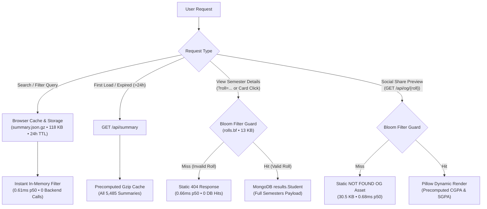

<p align="center">
  
</p>

# nith-results-website

Modernized student result portal and academic performance explorer for National Institute of Technology Hamirpur (NITH).

## Architecture Overview



## Performance Benchmarks: v2.0 vs v1.0

| Metric / Scenario | v1.0 (Baseline) | v2.0 (Overhaul) | Improvement |
|---|---|---|---|
| **Search Query (`"20"`) Payload** | 5,620,692 Bytes (873 full documents) | 121,534 Bytes (`summary.json.gz`, all 5,485 students) | **46.2x smaller** (fetched once/day) |
| **Search Query Latency** | 20,751.69 ms p50 (23,689.34 ms mean) | 0.61 ms p50 (in-memory client filtering) | **~34,000x faster** (warm) |
| **Invalid Roll OG Request** | MongoDB query miss + on-the-fly Pillow render | 0.68 ms p50 (Bloom filter + static `og_not_found.png`) | **0 DB queries, 0 render CPU** |
| **Invalid Roll Detail Lookup** | MongoDB query miss | 0.66 ms p50 (Bloom filter 404 guard) | **0 DB queries** |
| **Valid Roll OG Generation** | DB fetch + O(semesters * subjects) grade loops + render | 306.00 ms p50 (precomputed `cgpa`/`sgpa` on doc) | **No runtime grade computation** |
| **Semester Detail Fetch** | Monolithic load upfront on every search | 431.10 ms p50 (lazy load on modal open + 24h cache) | **Loaded on demand only** |

## Architecture

* **Frontend**: React 19 + TypeScript SPA with client-side CacheStorage for 24-hour summary persistence, instant in-memory multi-facet search/sorting across 5,485 records, and lazy semester detail fetching.
* **Backend**: FastAPI + Beanie with BLAKE2b double-hashing Bloom filter guard, static 404 OG image generation, precomputed `cgpa`/`sgpa` indexing, and level-9 gzip summary caching.
* **Database**: MongoDB compound-indexed on `(year, degree, branch, student_info.roll_number)` with prefix-indexed student names.
* **Deployment**: Configured for Vercel serverless functions with optimized edge routing (`vercel.json`).

## Project Layout

* `frontend/`: Single-page application interface, client-side summary cache, and components.
* `backend/`: FastAPI application, Bloom filter engine, OG image generator, and database models.
* `backend/assets/`: Precomputed binary Bloom filter (`rolls.bf`), static `og_not_found.png`, and precomputed `summary.json.gz`.
* `api/`: Serverless endpoint handlers for edge deployment.
* `test/`: Verification and parser test suites.

## Prerequisites

* Python 3.11+ with uv or pip
* Node.js 18+ with npm

## Setup and Development

### Install Dependencies

```bash
cd frontend && npm install
cd ../backend && pip install -r requirements.txt
```

### Run Locally

Run the backend server:

```bash
cd backend
uvicorn main:app --reload
```

In a separate terminal, start the Vite development server:

```bash
cd frontend
npm run dev
```

### Build

```bash
cd frontend
npm run build
```

## License

GPL-3.0-or-later. See LICENSE for details.
